<p align="center">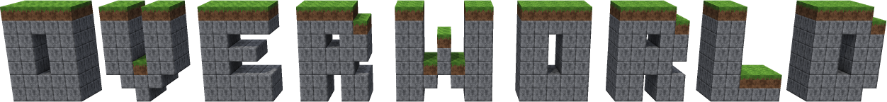</p>

<h1 align="center">Overworld Hyprland</h1>

<p align="center"><b>Your Hyprland desktop, as a Minecraft world.</b><br>
The Quickshell shell is the game&rsquo;s HUD and menus; windows are mined when you close them and placed when you open them.</p>

<p align="center">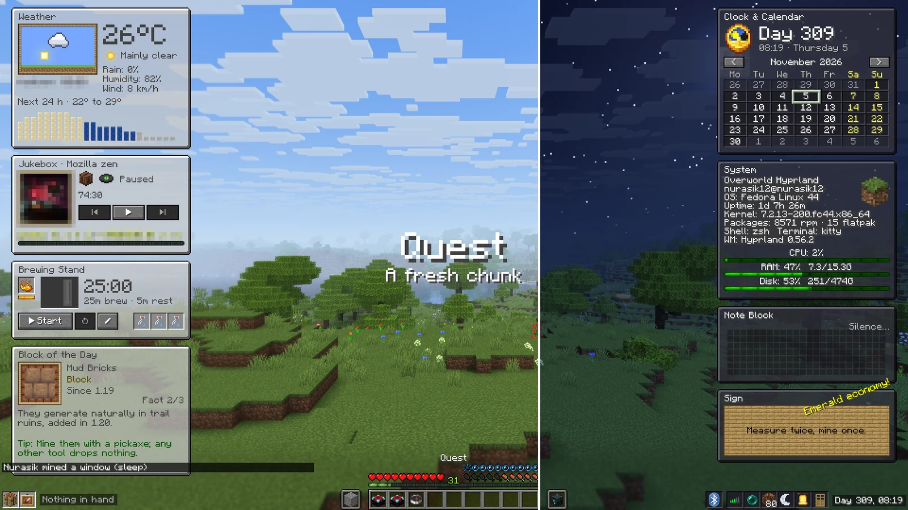<br>
<sub>One desktop, two modes: <b>Day</b> on the left, <b>Night</b> on the right.</sub></p>

A Minecraft-inspired theme for a real Hyprland desktop. The desktop is a Minecraft world and the Quickshell shell
is its HUD and menus: a hotbar for workspaces, hearts for the battery, a creative inventory for the launcher, toasts
for notifications, a chat console that runs `/` commands, advancements for desktop events. Every surface copies the
game's own GUI and behaviour (20-tick animations, nine-slice sprites, hover highlights), and windows are mined when
you close them and placed when you open them.

Two modes, switchable live. The CLI names are `light` and `dark`:

| CLI name | in the theme | feel |
|---|---|---|
| `light` | Day | classic Java GUI: light-grey bevelled panels, dark text, grass-and-sky worlds |
| `dark` | Night | deepslate and obsidian GUI, white text with drop shadows, moon, stars and nether accents |

A day/night cycle can switch them by itself at local sunrise and sunset (`daycycle` in `config.json`, or `/time set auto`).

<p align="center">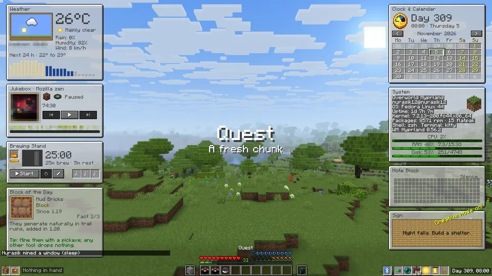<br><sub>Day and Night, flipped with <code>SUPER+T</code>.</sub></p>

> **New to this?** Read [docs/GUIDE.md](docs/GUIDE.md): it explains how the pieces fit together, traces one key press
> through the real files, and shows how to add a chat command, an advancement, a widget card or a sound.

Contents: [showcase](#showcase) - [theme system](#a-theme-system-you-can-switch-on-and-off) - [tour](#feature-tour) -
[install](#requirements-and-install) - [first run](#first-run) - [keybinds](#keybind-cheat-sheet) - [CLI](#cli-reference) -
[config](#configjson-keys) - [repo layout](#layout-of-the-repo) - [docs](#docs) - [credits](#credits-and-licence)

## Showcase

Every image below is a real capture of the running theme on a 1920x1080 Hyprland desktop (Fedora 44, Hyprland 0.56,
Quickshell 0.3), taken during the QA pass, with a few personal details blurred. Keys are the ones from
[docs/KEYBINDS.md](docs/KEYBINDS.md) and work while the theme is on. The lock and login images are labelled as what they are.

### The HUD

The bar is Minecraft's in-game HUD, pinned to the bottom centre: workspaces are hotbar slots (the item is the busiest app,
the stack count is the window count), the battery is hearts, free RAM is hunger, CPU headroom is air bubbles, uptime is the
XP level and bar. A boss bar appears at the top while a brew runs or media plays. Eight see-through cards sit on the wallpaper.
<table>
<tr>
<td align="center" valign="top">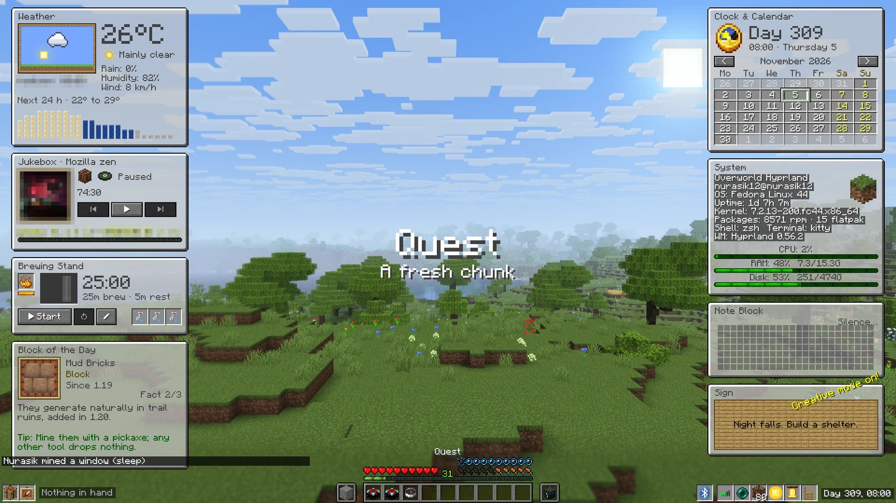<br><sub><b>Day</b>: hotbar, hearts, hunger, air, XP level 31, the eight widget cards (Weather, Jukebox, Brewing Stand, Block of the Day, Clock and Calendar, System, Note Block, Sign), chat line and the workspace /title card.</sub></td>
<td align="center" valign="top">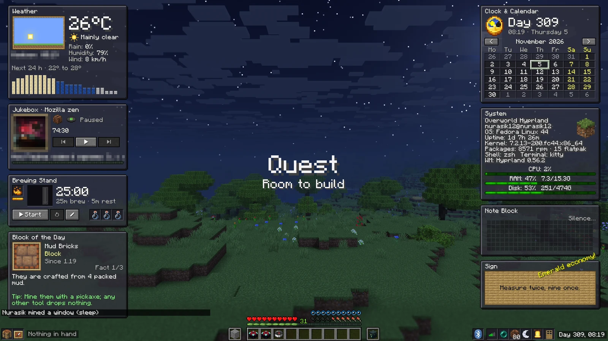<br><sub><b>Night</b>: the same shell in the deepslate palette. <code>SUPER+T</code> flips Day/Night, <code>SUPER+G</code> shows or hides the cards, <code>SUPER+F1</code> hides the HUD.</sub></td>
</tr>
</table>
<table>
<tr>
<td align="center" valign="top">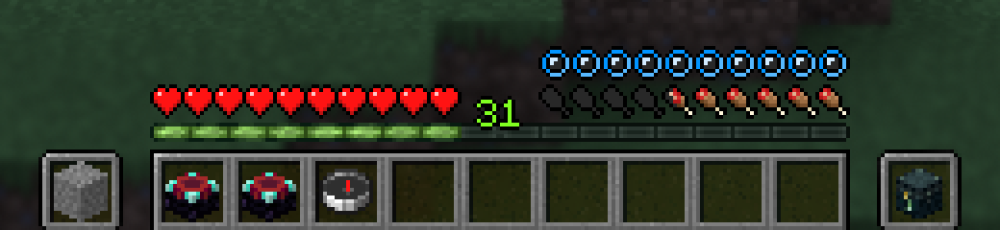<br><sub>Hearts (battery), hunger (RAM), air bubbles (CPU), XP bar and level (uptime), hotbar with the offhand slot for workspace 10. Hover a slot for a tooltip with the title and note.</sub></td>
<td align="center" valign="top">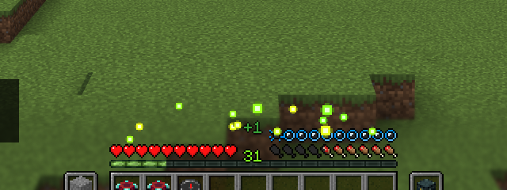<br><sub>XP orbs and sparkle on a level-up: one level per hour of uptime, with a <code>+1</code> next to the XP bar.</sub></td>
</tr>
</table>
<p align="center">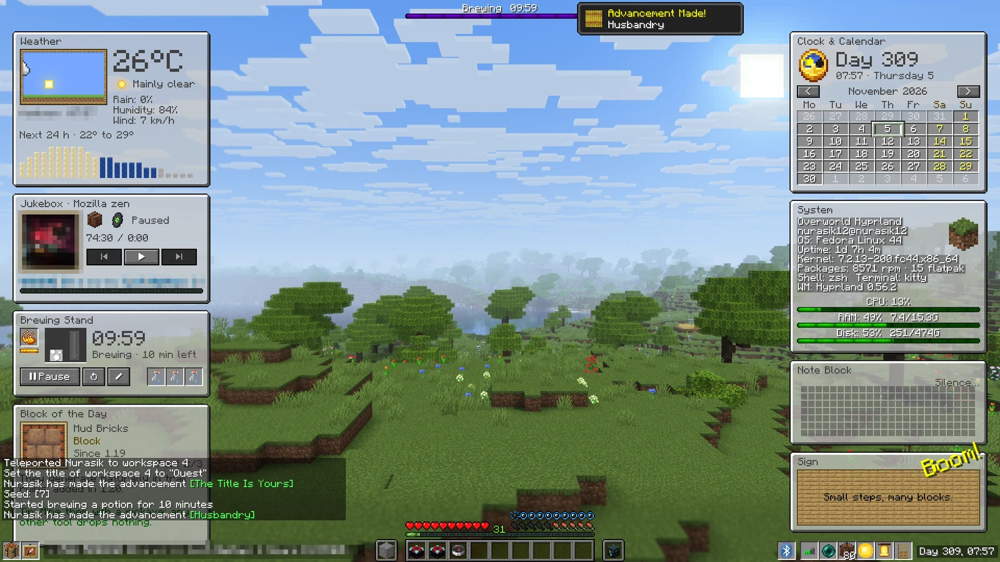<br><sub><b>Boss bar and brew.</b> A purple "Brewing 09:59" boss bar at the top centre while a brew runs, an advancement toast beside it, the Brewing Stand card, and fading chat lines that log system events. <code>SUPER+B</code> starts or pauses a brew, <code>SUPER+SHIFT+B</code> opens the brewing stand dialog.</sub></p>
<table>
<tr>
<td align="center" valign="top">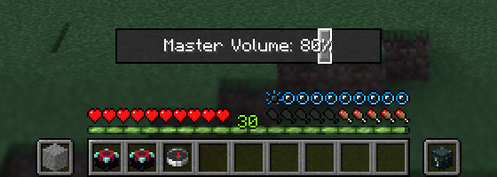<br><sub><b>Master Volume: 80%</b> is the Options slider; the volume keys (<code>XF86AudioRaiseVolume</code> and friends) open it.</sub></td>
<td align="center" valign="top">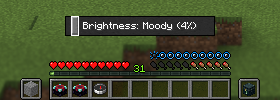<br><sub><b>Brightness: Moody (4%)</b> uses the labels of the real option, "Moody" to "Bright" (<code>XF86MonBrightnessUp/Down</code>).</sub></td>
</tr>
</table>
<p align="center">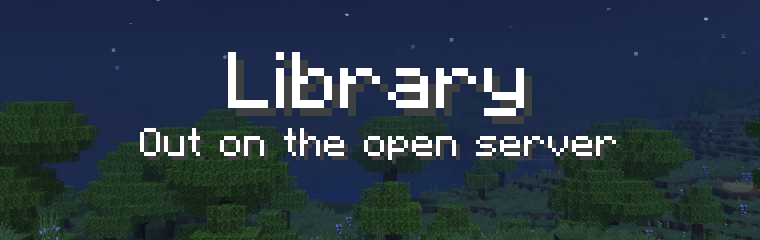<br><sub><b>/title workspace card.</b> Switching workspace (<code>SUPER+1...0</code>) shows the workspace title and subtitle with the game&rsquo;s /title timing (fade-in 10 ticks, stay 70, fade-out 20). Titles come from <code>overworld ws ...</code> or <code>/title &lt;ws&gt; &lt;text&gt;</code>.</sub></p>

### Screens

<table>
<tr>
<td align="center" valign="top">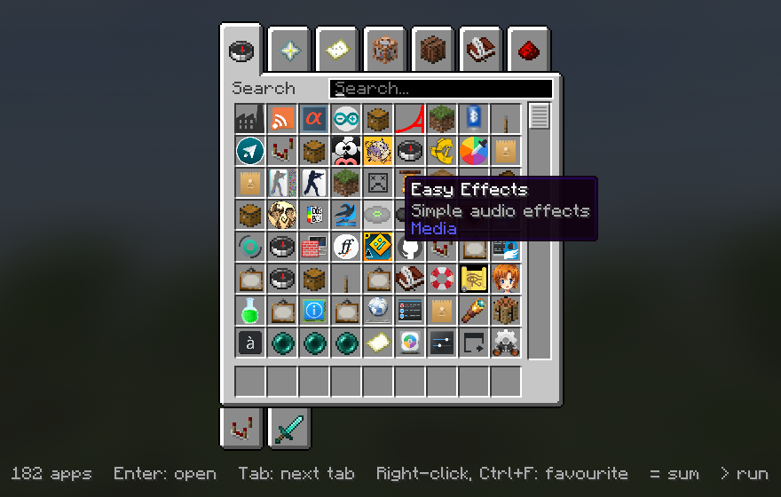<br><sub><b>Creative inventory launcher</b> (<code>SUPER+Space</code> or <code>SUPER+D</code>), Day: category tabs, a 9-column grid of app icons, a purple-bordered tooltip with name, description and category.</sub></td>
<td align="center" valign="top">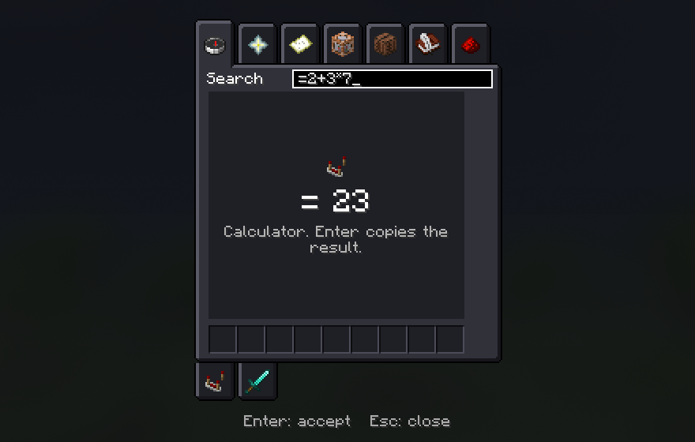<br><sub>Night, calculator mode: start the search with <code>=</code> (here <code>=2+3*7</code> gives 23, Enter copies it); <code>&gt;</code> runs a command.</sub></td>
</tr>
</table>
<table>
<tr>
<td align="center" valign="top">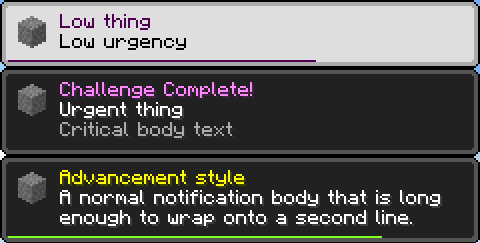<br><sub><b>Toasts.</b> Notifications slide in at the top right: low urgency, a purple <b>Challenge Complete!</b> for urgent ones, and the yellow advancement style for normal ones.</sub></td>
<td align="center" valign="top">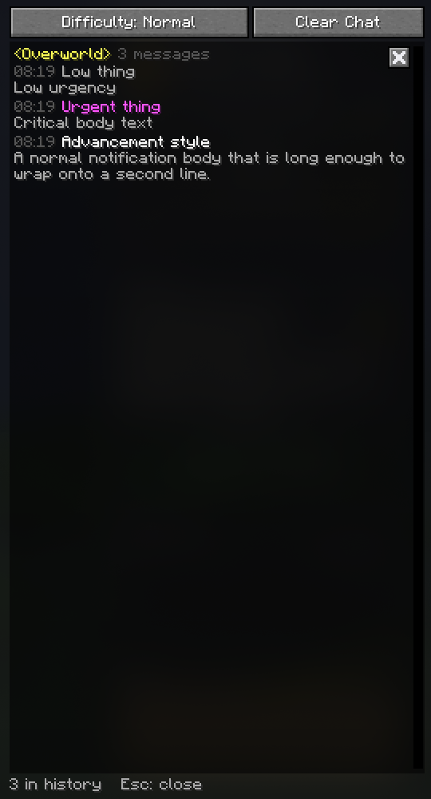<br><sub><b>Chat history</b> (<code>SUPER+I</code>) is the notification centre; the "Difficulty" button is Do Not Disturb ("Peaceful", <code>SUPER+SHIFT+I</code>).</sub></td>
</tr>
</table>
<table>
<tr>
<td align="center" valign="top">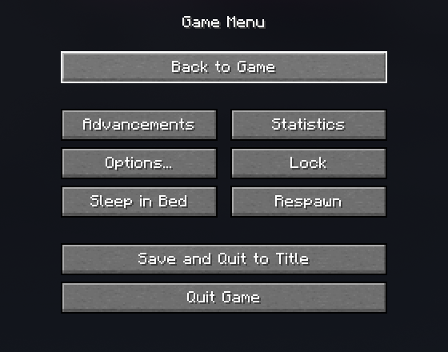<br><sub><b>Game Menu</b> (<code>SUPER+Escape</code>): Back to Game, Advancements, Statistics, Options, Lock, Sleep in Bed (suspend), Respawn (reboot), Save and Quit to Title (log out), Quit Game (shutdown, behind an "Are you sure you want to quit the game?" confirm screen).</sub></td>
<td align="center" valign="top">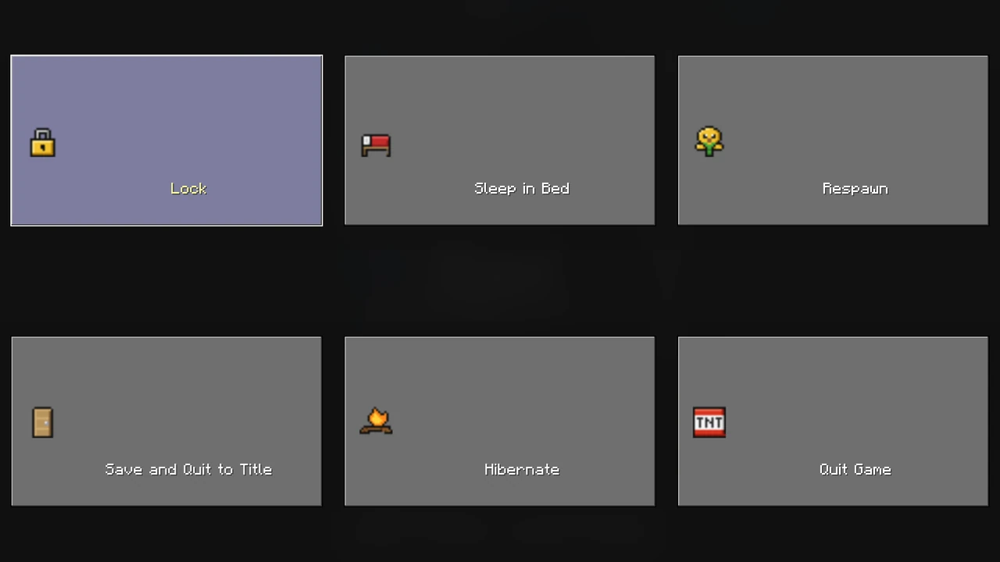<br><sub>The themed <b>wlogout</b> grid (<code>CTRL+ALT+P</code>) with the same Minecraft icons.</sub></td>
</tr>
</table>
<p align="center">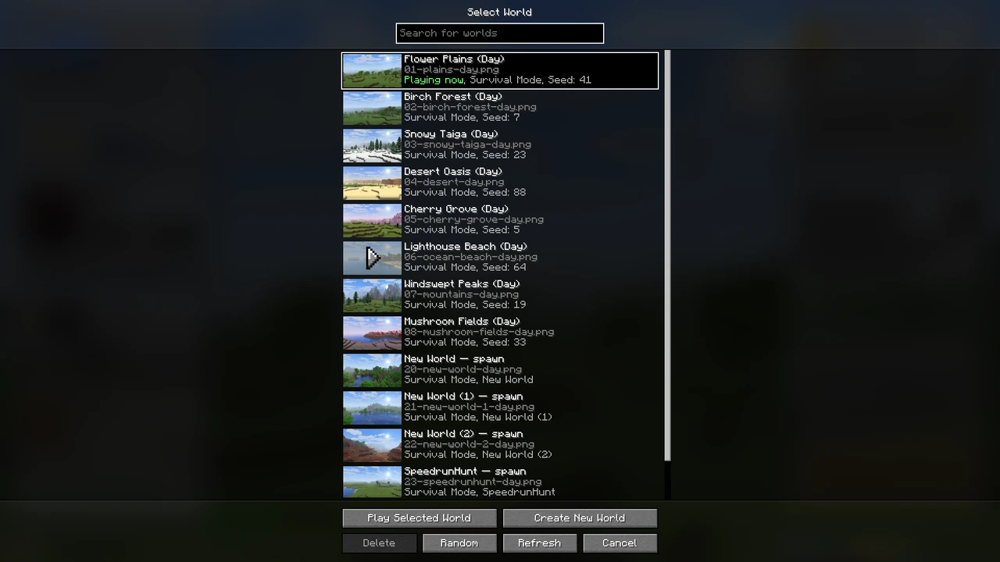<br><sub><b>Select World</b> (<code>SUPER+W</code>) is the wallpaper picker: thumbnail, name, file and seed per row. <b>Play Selected World</b> applies it, <b>Create New World</b> renders a new procedural world wallpaper in the background (behind a "Generating world..." screen), <b>Random</b> picks one. <code>SUPER+SHIFT+W</code> is the next wallpaper.</sub></p>
<table>
<tr>
<td align="center" valign="top">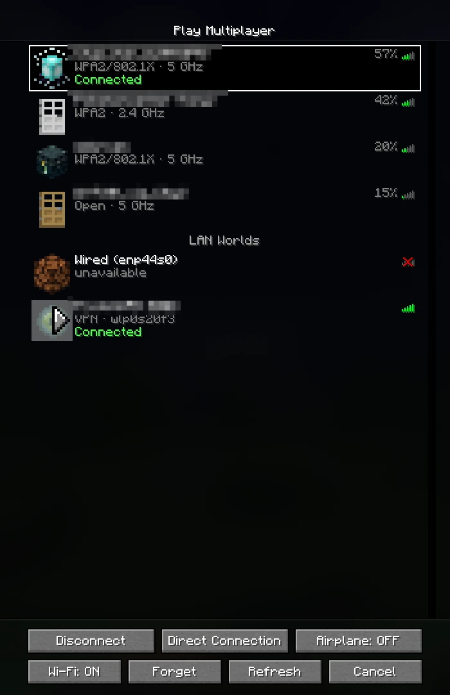<br><sub><b>Multiplayer</b> (<code>SUPER+N</code>): Wi-Fi networks are servers with signal as ping bars and the security line as the MOTD; wired and VPN connections are LAN worlds; Direct Connection joins a hidden SSID. Network names are blurred here.</sub></td>
<td align="center" valign="top">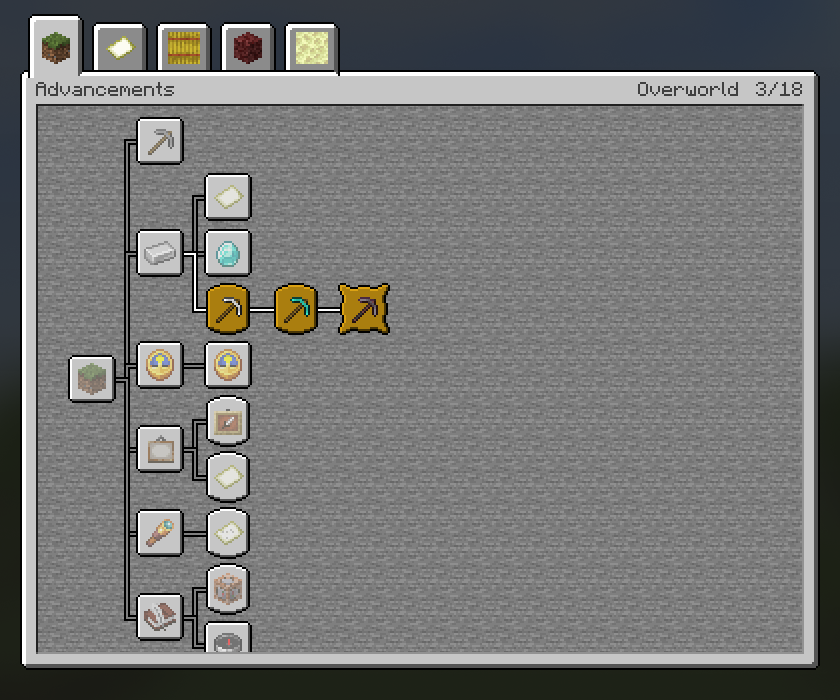<br><sub><b>Advancements</b> (<code>SUPER+L</code>): a tree of 60 advancements in five tabs, unlocked by real desktop events (first terminal, first brew, windows mined, uptime ...).</sub></td>
</tr>
</table>
<table>
<tr>
<td align="center" valign="top">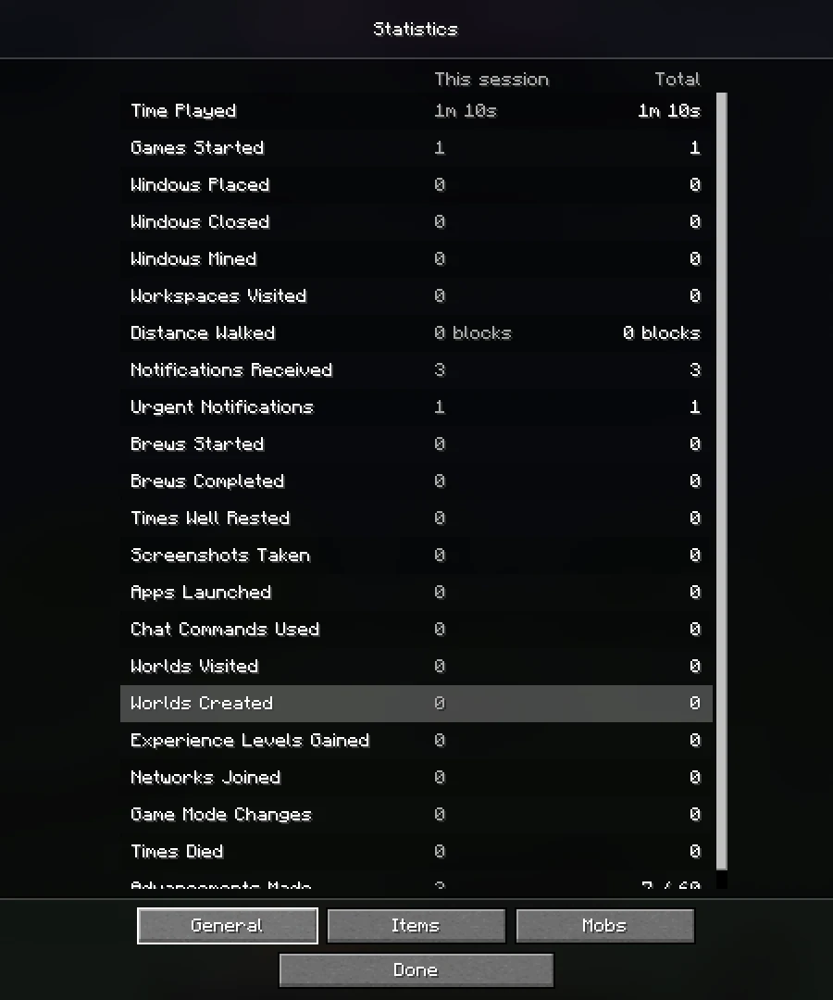<br><sub><b>Statistics</b> (<code>SUPER+SHIFT+L</code>): counts of shell and Hyprland events (windows placed and mined, workspaces visited, brews, notifications ...). No keystrokes are recorded.</sub></td>
<td align="center" valign="top">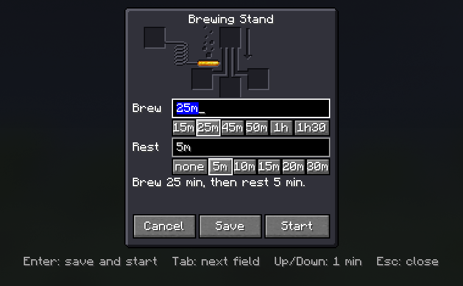<br><sub><b>Brewing stand</b> dialog (<code>SUPER+SHIFT+B</code>): brew and rest times with presets.</sub></td>
</tr>
</table>
<table>
<tr>
<td align="center" valign="top">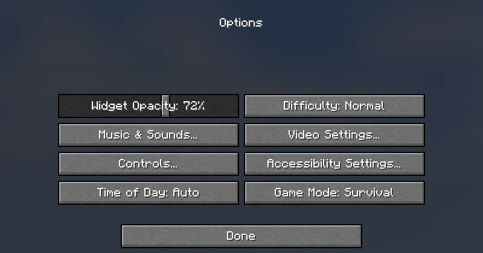<br><sub><b>Options</b> (<code>SUPER+O</code>), Day: widget opacity, difficulty (Peaceful = Do Not Disturb), time of day (Auto/Day/Night), game mode. It edits <code>config.json</code> live.</sub></td>
<td align="center" valign="top">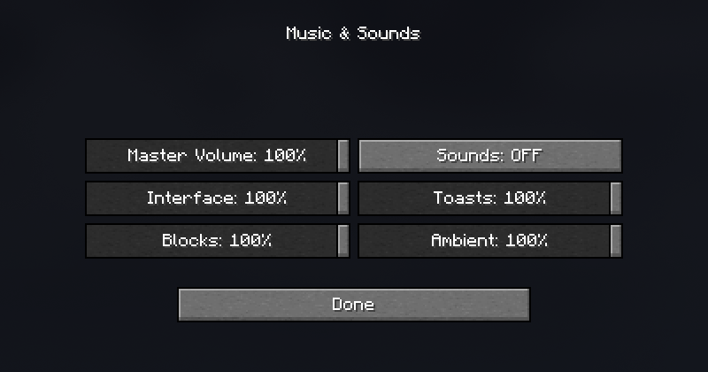<br><sub>Options &gt; <b>Music &amp; Sounds</b>, Night: master, interface, toasts, blocks and ambient volume sliders.</sub></td>
</tr>
</table>

### Game systems

<p align="center">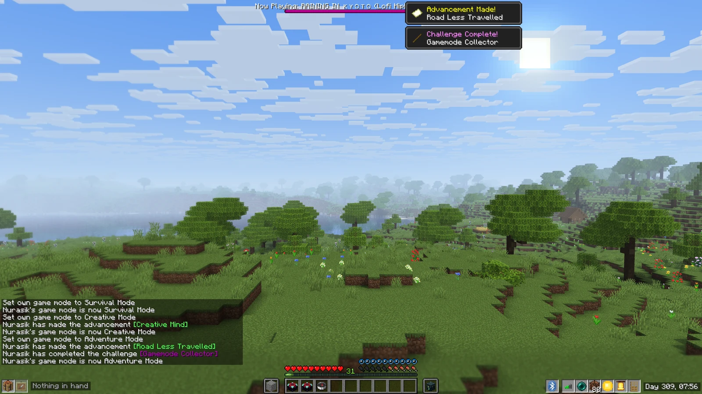<br><sub><b>Chat console</b> (<code>SUPER+SHIFT+T</code>, or <code>SUPER+/</code> with a <code>/</code> typed): <code>/help</code>, <code>/time</code>, <code>/weather</code>, <code>/gamemode</code>, <code>/tp</code>, <code>/give</code>, <code>/locate</code>, <code>/kill</code>, <code>/brew</code>, <code>/title</code>, <code>/advancement</code>, <code>/stats</code>, <code>/f3</code>, <code>/seed</code> ... with Tab completion and history. Here <code>/gamemode</code> changes and the advancements they unlock are logged as chat lines.</sub></p>
<table>
<tr>
<td align="center" valign="top">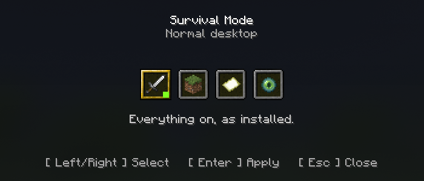<br><sub><b>Game mode switcher</b> (<code>SUPER+F4</code>): survival, creative, adventure (performance mode) and spectator.</sub></td>
<td align="center" valign="top">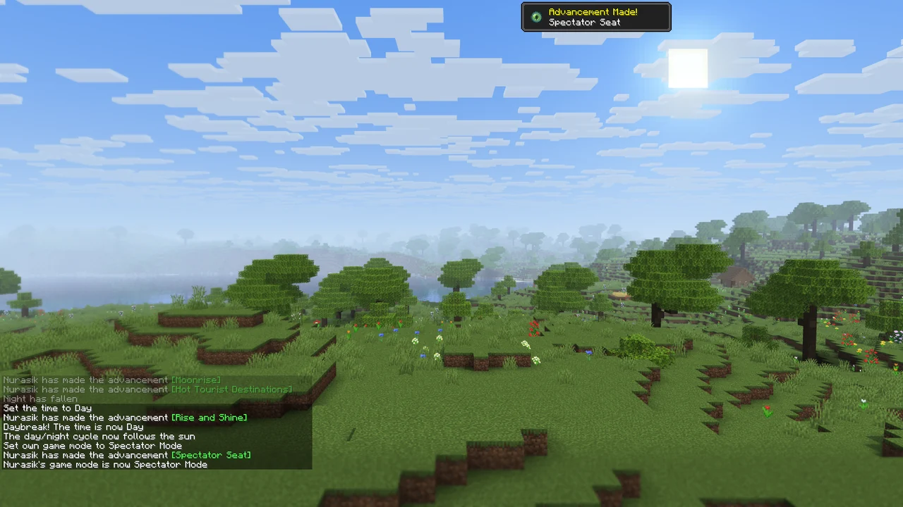<br><sub><b>Spectator</b> (<code>overworld gamemode spectator</code>) is focus mode: HUD and cards hidden, gaps 0, Do Not Disturb on; the chat log stays.</sub></td>
</tr>
</table>

### World effects

Real weather (Open-Meteo) or a forced one: `/weather rain|snow|thunder|clear|auto` or `overworld weather ...`. The overlay uses Minecraft's rain and snow textures.

<table>
<tr>
<td align="center" valign="top">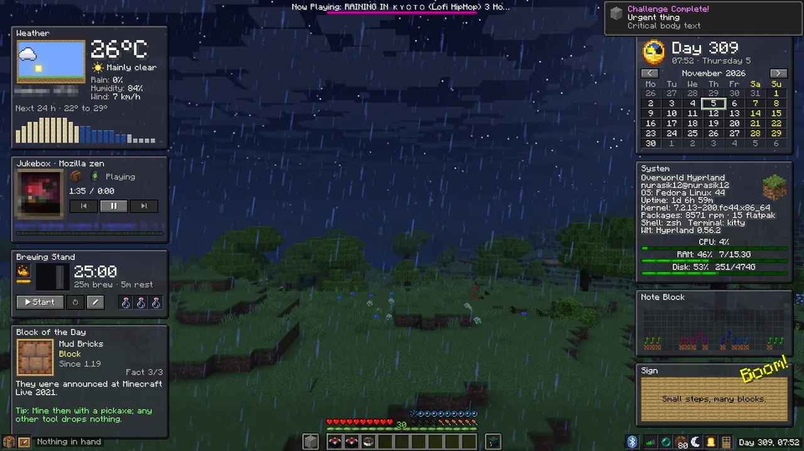<br><sub><b>Rain</b> (Night).</sub></td>
<td align="center" valign="top"><br><sub><b>Snow</b> (Day).</sub></td>
</tr>
</table>
<table>
<tr>
<td align="center" valign="top">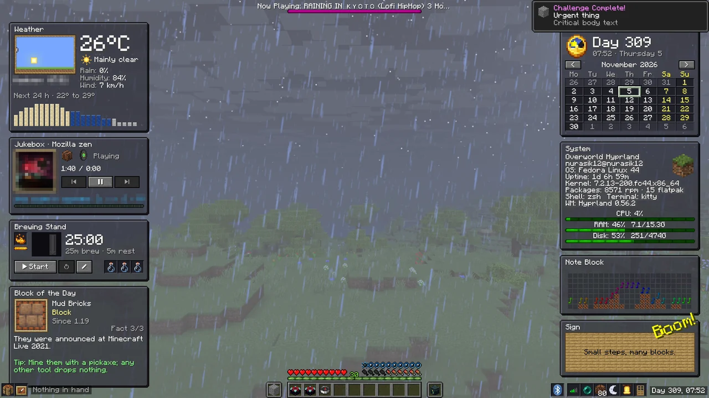<br><sub><b>Thunder</b>: the lightning flash lights the whole screen for a moment.</sub></td>
<td align="center" valign="top">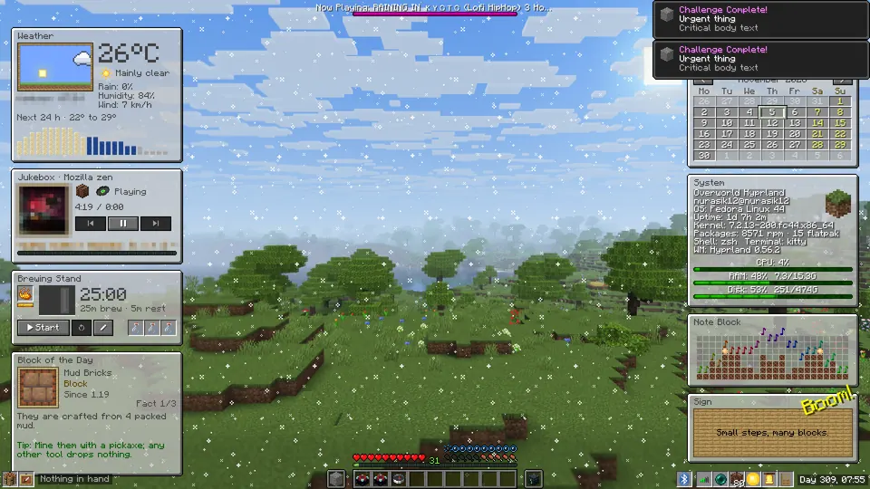<br><sub>Snow, rain and thunder in a loop (animation).</sub></td>
</tr>
</table>
<p align="center">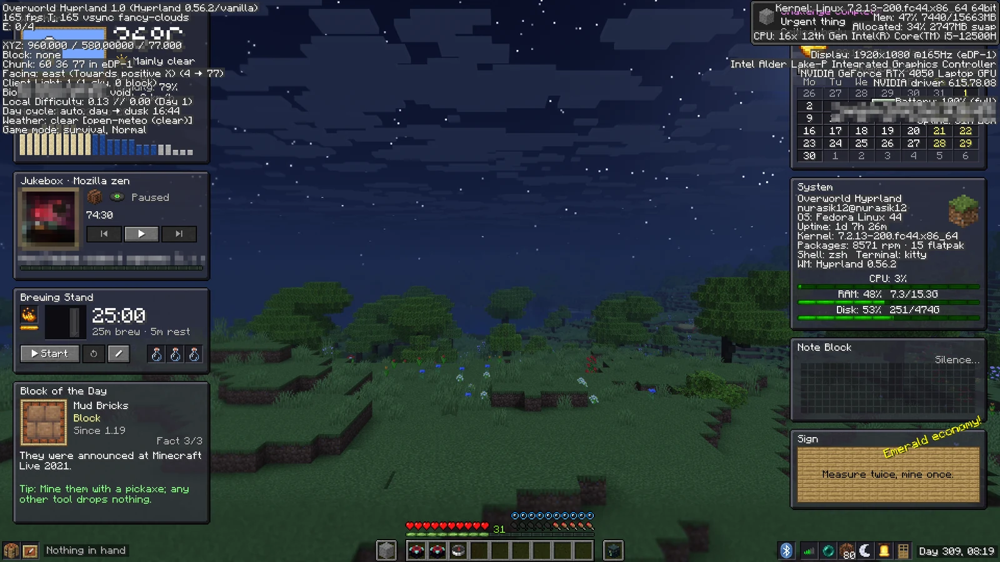<br><sub><b>F3 debug screen</b> (<code>SUPER+F3</code>, with a frame graph on <code>SUPER+SHIFT+F3</code>): live system values in the game&rsquo;s F3 layout (version, fps, "XYZ", biome = the wallpaper, local difficulty, weather, game mode) over the desktop. Parts of the right column are blurred. The day/night cycle that drives Day and Night is automatic by sunrise and sunset, or <code>/time set day|night|auto</code>.</sub></p>

### Interactions

Closing a window with `SUPER+Q` mines it: cracks grow over the window, break particles come out in its own colours, a break sound plays, then it closes.
Opening one plays a place sound and dust. `Print` takes a screenshot and prints "Saved screenshot as ..." in chat with an item-pickup pop.

<table>
<tr>
<td align="center" valign="top">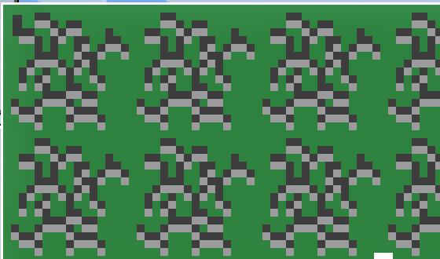<br><sub>Crack overlay on a plain green test window, Day.</sub></td>
<td align="center" valign="top">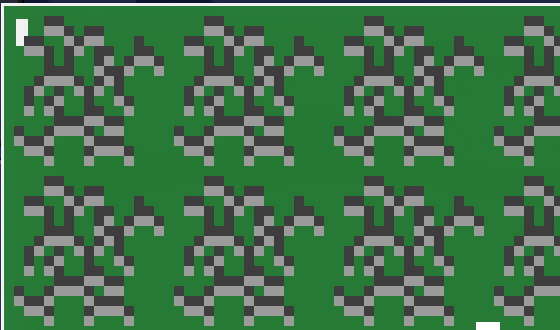<br><sub>The same, Night. The crack texture tiles and scales with the window size; this is a crop of a flat-colour test window, not a real app.</sub></td>
</tr>
</table>
<p align="center">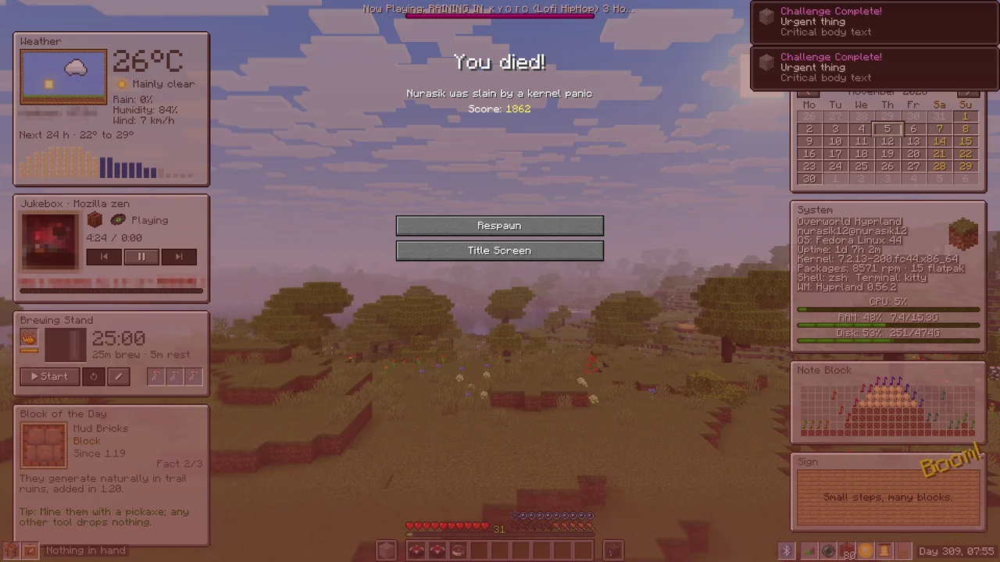<br><sub><b>"You died!" screen</b> at 5% battery while discharging (once per discharge): <b>Respawn</b> dismisses it, <b>Title Screen</b> locks the session. Triggered here with <code>qs -c overworld ipc call interact death</code>.</sub></p>

### Wallpapers and worlds

Wallpapers are voxel worlds rendered locally by `tools/worldgen`, one set per mode, and they include **your own Minecraft saves**: the author's
`~/.minecraft/saves` ("New World", "SpeedrunHunt" ...) are rendered as spawn-point wallpapers. `overworld world new` renders a new one.

<p align="center">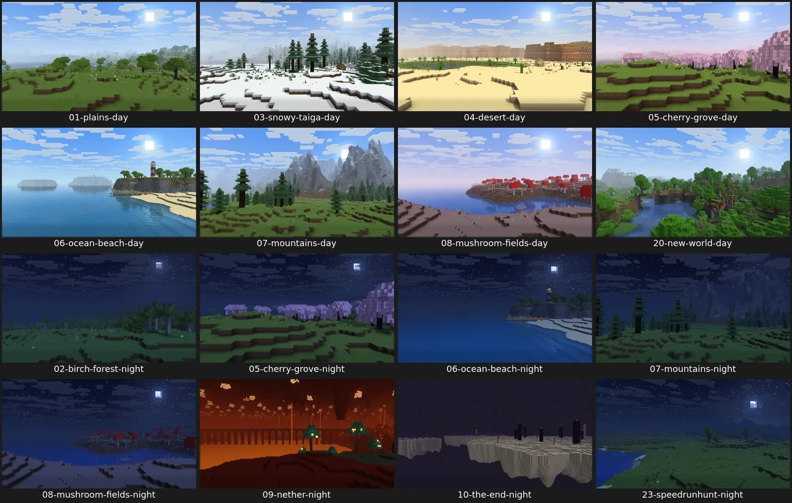<br><sub>Contact sheet of Day and Night wallpapers: plains, snowy taiga, desert, cherry grove, beach, mountains, mushroom fields, the author&rsquo;s saves, Nether and End.</sub></p>
<table>
<tr>
<td align="center" valign="top">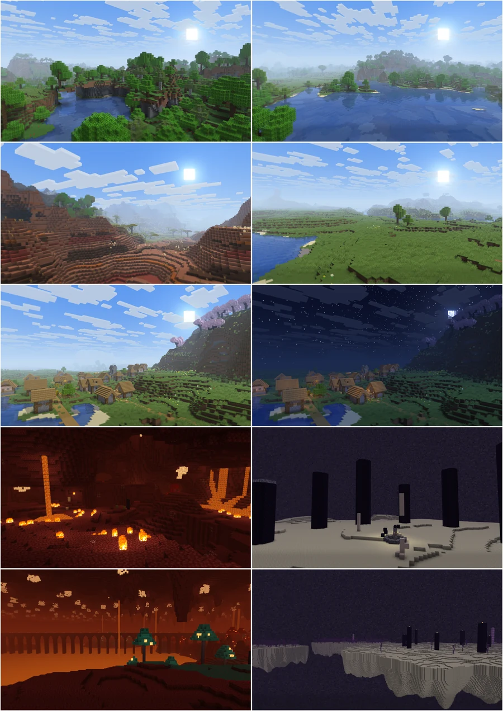<br><sub>Worlds rendered from the author&rsquo;s own saves (spawn points, Day and Night, Nether, End).</sub></td>
<td align="center" valign="top">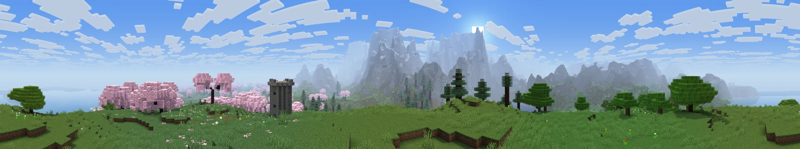<br><sub>The panorama strip that the lock screen and login theme pan across.</sub></td>
</tr>
</table>

### Lock and login

<table>
<tr>
<td align="center" valign="top">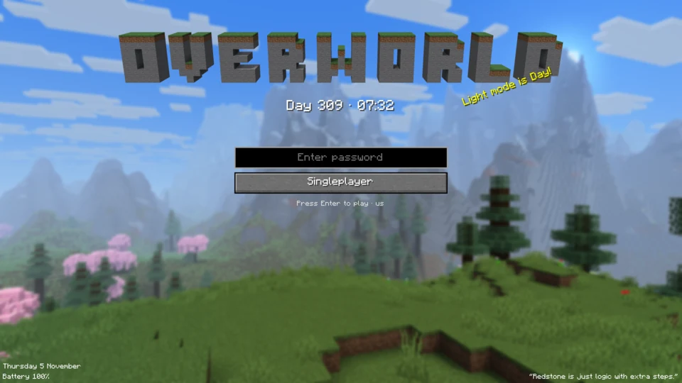<br><sub><b>Lock screen</b> (<code>CTRL+ALT+L</code>): the title screen with the OVERWORLD wordmark and a bouncing splash text. <b>This image is a simulation</b> (an ImageMagick composite of the hyprlock layout); hyprlock itself was not run during QA because it would lock the session.</sub></td>
<td align="center" valign="top">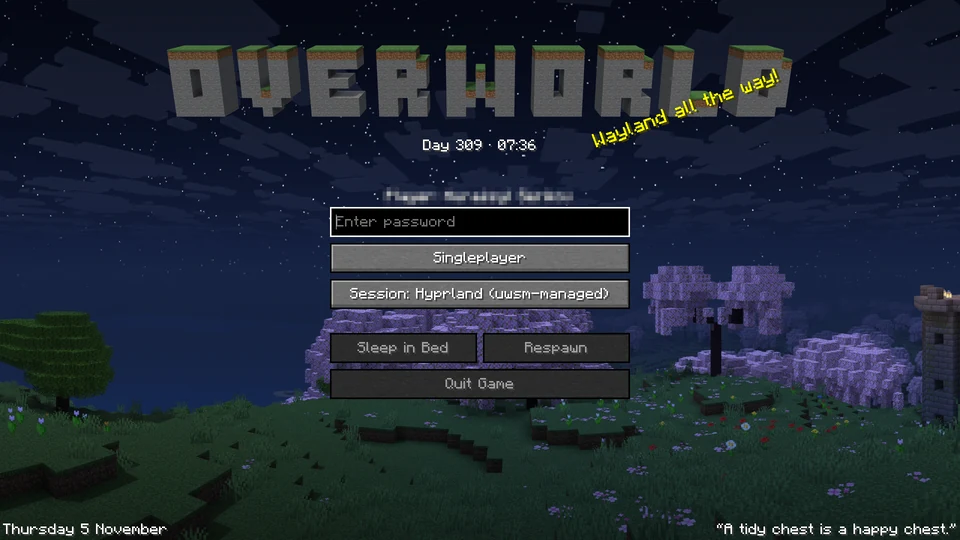<br><sub><b>Login theme</b> (SDDM, needs a sudo step), Night, captured with <code>sddm-greeter-qt6 --test-mode</code>: a real greeter render, not a login on a real display manager. A name line is blurred.</sub></td>
</tr>
</table>

### Apps

Everything you open follows the mode: `apps/apply-mode.sh` switches them all with the theme.

<p align="center">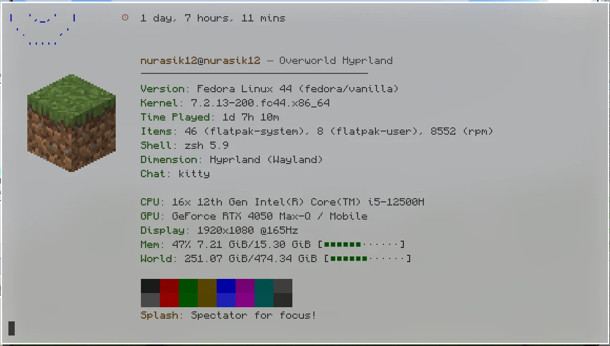<br><sub><b>kitty + fastfetch</b>: Monocraft font, the grass block logo, "Time Played / Items / Dimension" labels.</sub></p>
<p align="center">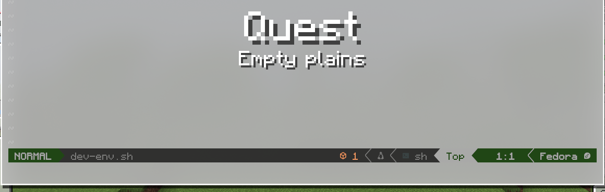<br><sub><b>Neovim</b>: the Lua palette generated from the same tokens (title card and status line, cropped).</sub></p>
<table>
<tr>
<td align="center" valign="top">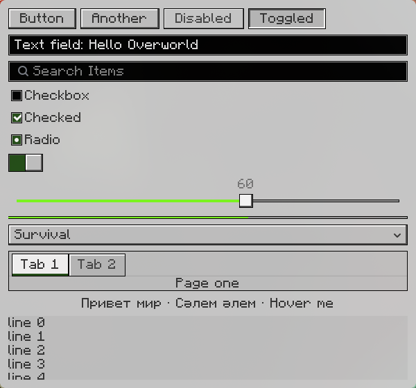<br><sub><b>GTK3/4</b> widgets, Day.</sub></td>
<td align="center" valign="top">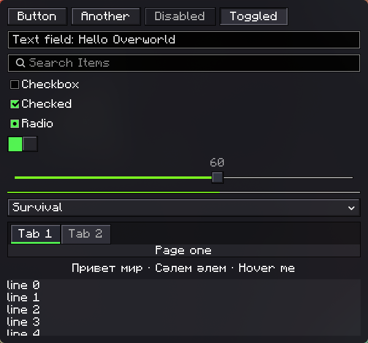<br><sub><b>GTK3/4</b> widgets, Night.</sub></td>
</tr>
</table>
<table>
<tr>
<td align="center" valign="top">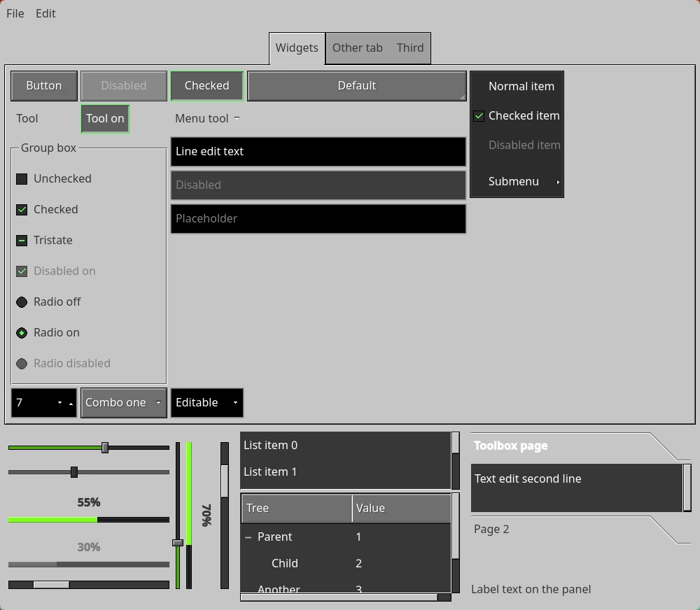<br><sub><b>Kvantum / qt6ct</b> (Qt apps), Day.</sub></td>
<td align="center" valign="top">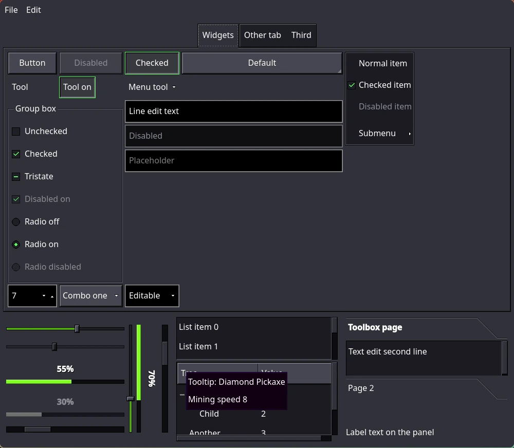<br><sub><b>Kvantum / qt6ct</b>, Night, with the purple Minecraft tooltip.</sub></td>
</tr>
</table>

rofi, superfile, btop, cava, starship, Zen and swappy are themed too ([docs/APPS.md](docs/APPS.md)).

### Cursor

<p align="center">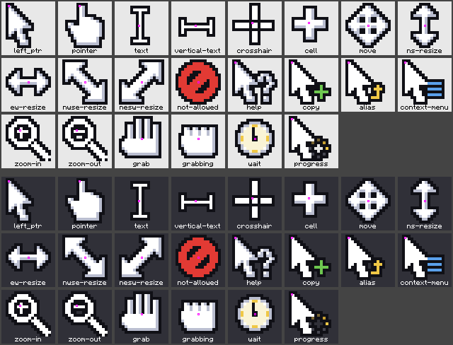<br><sub><b>Overworld cursor theme</b>: 22 original 16x16 pixel shapes (arrow, hand, I-beam, resize, wait clock ...), Xcursor and hyprcursor, on a light and a dark background (a preview sheet, not a desktop capture).</sub></p>

> Screenshots show Minecraft textures, fonts and wallpapers (c) Mojang Studios, used for demonstration only. This repository does not ship Mojang assets.
> Personal details (Wi-Fi names, track titles and album art, location, a login name line) are blurred.


## A theme system you can switch on and off

Overworld Hyprland is a theme system layered on top of
[JaKooLit's Fedora-Hyprland dotfiles](https://github.com/JaKooLit/Fedora-Hyprland); nothing of the base config is
edited in place. It coexists with the author's earlier theme, Apothecary Hyprland: both stay installed, at most one is on.

```sh
overworld on       # Hyprland layer, HUD shell, hyprlock/hypridle, app themes, wallpaper
overworld off      # back to what was there before: Apothecary in its mode, or the stock JaKooLit desktop
overworld status   # enabled, mode, previous theme, game mode, day cycle, processes
```

- `scripts/install.sh` adds one line to `~/.config/hypr/hyprland.conf` (after Apothecary's line if there is one) that
  sources `~/.config/hypr/overworld.conf`. That file only sources `~/.config/overworld/active.conf`, a symlink the
  CLI points at `hypr/on.conf` (the theme) or `hypr/off.conf` (empty), followed by `hyprctl reload`.
- `on` records what it replaces in `~/.config/overworld/previous-theme` (`apothecary dark`, `apothecary light` or
  `stock`). If Apothecary is on, it is switched off first. Then waybar and the notification daemons stop,
  `qs -c overworld` starts, and the theme's hyprlock/hypridle configs, wallpaper and app themes are applied.
- `off` reverses all of it for whatever was there before. If that was Apothecary, it comes back in the mode it was in
  (waybar and mako are not started); if it was stock, waybar, mako, the stock hypridle, your old wallpaper and your
  `hyprlock.conf` return.
- The state survives logout and reboot (`~/.config/overworld/enabled`). Off is not uninstall: `scripts/uninstall.sh`
  removes the hook and links. The SDDM login theme is separate and needs sudo ([docs/SUDO-STEPS.md](docs/SUDO-STEPS.md)).
- Day/Night (`SUPER+T`) is a separate switch inside the theme.

> **Careful with `install.sh` and `uninstall.sh`.** They do not have a `--help` mode: running them with any argument
> still performs the install or uninstall (and `uninstall.sh` turns the theme off). Read them before running.

## Feature tour

### The HUD (the bar is Minecraft's in-game HUD)

Everything here lives in `quickshell/Bar/` and `quickshell/Common/`. Pinned to the bottom centre, like the game's HUD
(layout comment at the top of `quickshell/Bar/Bar.qml`).

| Desktop thing | Minecraft thing | Component | Behaviour |
|---|---|---|---|
| workspaces 1-9, 10 | hotbar slots, offhand slot | `Bar/Hotbar.qml` | selection frame snaps; the item is the busiest app on that workspace (`tokens/items.json`), the stack count is the window count; hover = tooltip with title and note; wheel cycles; the item name pops above the hotbar on a switch |
| battery | hearts | `Common/HeartsRow.qml` | regen pulse while charging, hearts jiggle at 2 hearts or fewer, hardcore hearts when critical |
| free RAM | hunger (drumsticks) | `Common/HungerRow.qml` | fills from the right; shakes when swap is heavily used |
| CPU headroom | air bubbles | `Common/AirRow.qml` | bubbles burst as load rises |
| uptime | XP level and XP bar | `Bar/Bar.qml`, `Bar/LevelSparkle.qml` | level = hours of uptime, bar = progress through the hour; sparkle on each new level |
| brew timer, else playing media | boss bar (top centre) | `Bar/BossBar.qml` | only while active: "Brewing: <task>" or "Now Playing: <title>" (`hud.bossbar_media`) |
| tray, Wi-Fi, Bluetooth, volume, widgets | slots at the HUD's flanks | `Bar/WifiChip.qml`, `BluetoothChip.qml`, `TrayItem.qml`, `WidgetsChip.qml` | wheel and middle-click where it makes sense |
| workspace title card | `/title` | `Osd/WorkspaceCard.qml` | fade-in 10 ticks, stay 70, fade-out 20 (the game's defaults; 1 tick = 50 ms) |
| volume / brightness | Options slider | `Osd/Osd.qml` | "Master Volume: 75%"; brightness labels from "Moody" to "Bright" |

### Screens and their keys

| Desktop thing | Minecraft thing | Key | Source |
|---|---|---|---|
| launcher | creative inventory (tabs, 9-column slot grid, tooltips; `=` calculator, `>` run) | `SUPER+Space` / `SUPER+D` | `Launcher/` |
| notifications | toasts ("Challenge Complete!" for urgent) | (automatic) | `Notifications/` |
| notification centre, Do Not Disturb | chat history, Peaceful difficulty | `SUPER+I`, `SUPER+SHIFT+I` | `Notifications/NotificationCenter.qml` |
| network panel | Multiplayer server list (signal = ping bars, hidden SSID = Direct Connection) | `SUPER+N` | `Network/` |
| power menu | Game Menu (Back to Game, Lock, Sleep in Bed, Save and Quit, Respawn, Quit Game) | `SUPER+Escape` | `Power/` |
| wallpaper picker | Select World (Create New World renders a new wallpaper) | `SUPER+W` | `Wallpapers/` |
| brew timer | brewing stand GUI | `SUPER+B`, `SUPER+SHIFT+B` | `Brew/`, `Widgets/BrewTimer/` |
| lock screen | title screen: our panorama, OVERWORLD wordmark, bouncing splash text | `CTRL+ALT+L` | `hypr/hyprlock.conf` |
| login (SDDM) | title screen with a slowly rotating panorama (needs sudo) | | `sddm/overworld/` |
| Options | Minecraft Options menu; edits `config.json` live | `SUPER+O` | `Game/OptionsScreen.qml` |

### Game systems (`quickshell/Game/`)

- **Chat console** (`SUPER+SHIFT+T`, or `SUPER+/` with `/` typed): `/help` lists the commands. `/time set day|night|auto`,
  `/weather clear|rain|thunder|snow|auto`, `/gamemode`, `/tp <1-10>`, `/give <app>`, `/locate <app>`, `/kill [class]`,
  `/brew 25m`, `/title <ws> <text>`, `/msg <text> in <duration>` (a real reminder), `/advancement`, `/stats`, `/f3`,
  `/seed`, `/clear`, `/reload`. Tab completes, Up/Down is history. System events appear as chat lines that fade after 10 s.
- **Game modes** (`overworld gamemode ...`, `SUPER+F4` switcher): *survival* is normal; *creative* removes the HUD warnings;
  *adventure* is the performance mode (animations, blur, shadows, gaps, rounding off, widgets hidden); *spectator* is focus
  mode (HUD and widgets hidden, gaps 0, Do Not Disturb on).
- **Advancements and statistics**: 60 advancements in five tabs (`quotes/advancements.json`), unlocked by real desktop events
  (first terminal, first brew, 100 windows mined, 3 hours of uptime, Wi-Fi connected ...). Statistics are counts of shell and
  Hyprland events only, no keystrokes.
- **Desktop widgets** (`SUPER+G`): eight cards on the wallpaper, draggable by the title bar: Weather (sky window), Jukebox
  (media), Brewing Stand, Block of the Day, Clock and Calendar, System (F3 style), Note Block (cava), Sign (quote).
  Opacity is `widgets.opacity` (default 0.72). See [docs/WIDGETS.md](docs/WIDGETS.md).

### World effects (`quickshell/World/`)

Day/night cycle from locally computed sun times with time-of-day wallpapers; a rain, snow and thunder overlay driven by
Open-Meteo weather or forced by `/weather`; the F3 debug screen (`SUPER+F3`, with a frame graph on `SUPER+SHIFT+F3`).
See [docs/WORLD.md](docs/WORLD.md).

### Interactions (`quickshell/Interact/`)

- Closing a window (`SUPER+Q`) mines it: crack stages over the window, break particles in the window's own colours, a
  material-dependent break sound, then it closes. Opening one plays a place sound and dust.
- `Print` takes a screenshot and prints "Saved screenshot as ..." in chat with an item-pickup pop.
- At 5 % battery while discharging a "You died!" screen appears (once per discharge). Respawn dismisses it.
- Each uptime hour is an XP level with orbs and a sparkle. See [docs/INTERACTIONS.md](docs/INTERACTIONS.md).

## Requirements and install

Fedora with JaKooLit's Hyprland dotfiles, Hyprland 0.56 (developed on 0.56.2), Quickshell (`qs`) 0.3, awww, kitty,
ImageMagick 7, jq, unzip, pw-play, nmcli, playerctl, grim and slurp. `uv` is needed for the world renderer and
the font and icon builds. Optional: the `claude` CLI (logged in) for workspace auto-labelling.

```sh
git clone <this repo> ~/Projects/overworld-hyprland && cd ~/Projects/overworld-hyprland
scripts/fetch-minecraft-assets.sh --build      # Mojang textures and sounds, then the local font and icons
(cd tools/worldgen && uv run python -m worldgen catalog)   # render the wallpaper set (docs/WORLDGEN.md)
scripts/install.sh                             # links the layer into ~/.config; idempotent; theme stays off
overworld on
```

Mojang assets are never committed. `scripts/fetch-minecraft-assets.sh` copies them from your own `~/.minecraft`
(read-only) or, if that is missing, downloads them from Mojang's servers into the gitignored `assets/mc/`. Anything
derived from them (wallpapers, renders, the bitmap font, icons) is built locally and also gitignored. Without the
assets the theme falls back to original art in `assets/gen/` (some fallbacks are incomplete, see `qa/REPORT.md`).

Full steps and removal: [docs/INSTALL.md](docs/INSTALL.md).

## First run

1. **Fetch assets and fonts**: the `fetch-minecraft-assets.sh --build` line above. Monocraft (the terminal font) and
   `Overworld Mojangles` (the proportional GUI font) are installed into `~/.local/share/fonts/overworld/`.
2. **Install and switch on**: `scripts/install.sh`, then `overworld on` (about a second). `overworld off` is always the way back.
3. **Sounds are your call.** A config created by `install.sh` has `"sounds": true`; a machine that was set up silent has
   `"sounds": false`. Switch on/off with Options > Music & Sounds (`SUPER+O`) or by editing `~/.config/overworld/config.json`.
   Test the sound paths without making noise: `OW_SOUND_DRYRUN=1 scripts/ow-sound ui.click`.
4. **Sudo step (optional)**: the SDDM login theme. `sudo ~/Projects/overworld-hyprland/scripts/install-sddm.sh`
   (see [docs/SUDO-STEPS.md](docs/SUDO-STEPS.md)). Nothing else needs root.
5. **Try the keys**: `SUPER+Space` (inventory), `SUPER+Escape` (Game Menu), `SUPER+SHIFT+T` then `/help` and Tab,
   `SUPER+F4` (game modes), `SUPER+L` (advancements). Mine a throwaway window with `SUPER+Q`. Lock once with `CTRL+ALT+L`.
6. **Workspace titles**: `overworld ws 1 "Code" "nvim and kitty"`; optional Claude labelling with `overworld ws auto on`.

## Keybind cheat sheet

Active only while the theme is on (`hypr/keybinds.conf`). The full table, with what each key replaced from JaKooLit, is in
[docs/KEYBINDS.md](docs/KEYBINDS.md).

| Key | Action |
|---|---|
| `SUPER+Space` / `SUPER+D` | creative inventory (launcher) |
| `SUPER+Q` | mine the window (crack animation, then it closes); `SUPER+SHIFT+Q` is the hard kill |
| `SUPER+Escape` | Game Menu |
| `SUPER+W` / `SUPER+SHIFT+W` / `CTRL+ALT+W` | Select World / next wallpaper / random wallpaper |
| `SUPER+T` | Day / Night |
| `SUPER+N` / `SUPER+I` / `SUPER+SHIFT+I` | Multiplayer (network) / chat history (notifications) / Peaceful (DND) |
| `SUPER+SHIFT+T` / `SUPER+/` | chat console / chat console with `/` typed |
| `SUPER+L` / `SUPER+SHIFT+L` / `SUPER+O` | advancements / statistics / options |
| `SUPER+F1` / `SUPER+F2` | hide the HUD / screenshot of everything |
| `SUPER+F3` / `SUPER+SHIFT+F3` / `SUPER+F4` | F3 debug screen / with frame graph / gamemode switcher |
| `SUPER+G` / `SUPER+B` / `SUPER+SHIFT+B` | desktop widgets / brew start-pause / brew dialog |
| `SUPER+E` | superfile |
| `SUPER+SHIFT+G` / `SUPER+ALT+R` | adventure (performance) mode / repair |
| `SUPER+SHIFT+Space` | float or tile the window (`SUPER+Space` is the launcher) |
| `Print` / `SHIFT+Print` / `ALT+Print` / `SUPER+SHIFT+S` | screenshot: area / screen / window / area then annotate |

`SUPER+Return`, `SUPER+1...0`, `SUPER+arrows` and the other JaKooLit binds are unchanged; see
[docs/HYPRLAND-GUIDE.md](docs/HYPRLAND-GUIDE.md).

## CLI reference

`overworld help` and `overworld help <verb>` print this (checked against `scripts/overworld`'s own help):

| Command | What it does |
|---|---|
| `overworld on` / `off` / `status` | enable the theme / disable and restore the previous one / show state |
| `overworld light` / `dark` / `toggle` | Day / Night / flip |
| `overworld reload` / `repair` | `hyprctl reload` and restart the shell / undo what JaKooLit scripts did to the theme |
| `overworld session-start` | run by Hyprland at login (no-op unless enabled); not for typing |
| `overworld wallpaper next\|prev\|random\|current\|pick\|<path>` | wallpaper for the current mode, remembered per mode |
| `overworld world new [--scene S] [--time T] [--mode light\|dark] [--seed N] [--out PATH]` | render a new world wallpaper (10-60 s). Scenes: plains birch-forest snowy-taiga desert cherry-grove ocean-beach mountains mushroom-fields nether the-end. Times: day dawn dusk night |
| `overworld gamemode survival\|creative\|adventure\|spectator\|switcher\|status` | game modes (`on`, `off`, `toggle` are old names for adventure / survival / flip) |
| `overworld weather clear\|rain\|thunder\|snow\|auto` | force the weather overlay, or follow the real weather; no argument prints it |
| `overworld daycycle auto\|day\|night\|off` | day/night cycle |
| `overworld f3 [on\|off\|toggle\|graph]` | the debug screen |
| `overworld kill [address]` | mine the focused window, or the one at that address (from `hyprctl clients`) |
| `overworld chat [text]` | open the console, or run a `/command` or say a line without opening it |
| `overworld advancements` / `stats` / `options` | the game screens |
| `overworld screenshot [area\|window\|screen\|swappy]` | saved to `~/Pictures/Screenshots` and copied |
| `overworld sound <id>` | play an id from `tokens/sounds.json` (honours `sounds` and volumes; `OW_SOUND_DRYRUN=1` prints instead) |
| `overworld ws ...` | workspace titles and notes, Claude auto-labelling (`overworld help ws`) |
| `overworld brew ...` | brew timer (`brew set 50 10`, `brew start`, `brew toggle`, `brew rest 0`; `overworld help brew`) |
| `overworld event <name> ['<json>']` | post to the event bus (`$XDG_RUNTIME_DIR/overworld/events.jsonl`) |

Other tools: `scripts/ow-sound --list` (all sound ids), `scripts/fetch-minecraft-assets.sh [--build] [--sounds-only]
[--force] [--download] [--version V]`. The shell's own commands go through `qs -c overworld ipc call <target> <function>`;
the targets are `launcher network power wallpapers notifications theme osd workspace hud shell brew widgets chat
advancements stats options gamemode world interact` (see [docs/QUICKSHELL.md](docs/QUICKSHELL.md)).

## config.json keys

`~/.config/overworld/config.json` is watched live. The Options screen (`SUPER+O`) edits most of these; missing keys use the default.
Defaults are in `quickshell/Services/ConfigService.qml`.

| Key | Default | Meaning |
|---|---|---|
| `sounds` | `true` | master switch for `scripts/ow-sound` |
| `sound_volume.master` `.ui` `.toasts` `.blocks` `.ambient` | 100 | 0-100 |
| `gui_scale` | `2` | 1-4 or `"auto"` (integer scale of all pixel art) |
| `animations` / `reduced_motion` | `true` / `false` | `reduced_motion` or `animations:false` = instant closes, no particles |
| `particles` | `"all"` | `"all"`, `"decreased"`, `"minimal"` |
| `weather_effects` | `true` | the rain/snow overlay |
| `daycycle` | `"auto"` | `"auto"`, `"day"`, `"night"`, `"off"` |
| `difficulty` | `"normal"` | `"peaceful"` = Do Not Disturb |
| `widgets.opacity` | `0.72` | desktop card fill opacity |
| `death_screen` | `true` | the "You died!" screen at 5 % battery |
| `hud.bossbar_media` | `"playing"` | `"playing"`, `"track"`, `"off"` |
| `notifications.timeout.low` / `.normal` | 4000 / 7000 | ms |
| `workspace_card.enabled` `.duration` `.position` `.show_untitled` | true, 0, `"center"`, true | the /title card |
| `workspace_auto.enabled` (+ `model`, `settle`, `cooldown`, `recheck`, `reset_after`, `max_per_hour`, ...) | false | Claude labelling, see `overworld help ws` |
| `interact.break` `.break_ms` `.hit_every` `.place` | true, 450, 2, true | block-break / place effects |
| `brew.work` / `brew.break` | 25 / 5 | minutes, or a string like `"90s"` |
| `weather.lat` `.lon` `.name` | unset | location for sun times and the Weather card |
| `weather_thunder_sound` | `false` | thunder sound with the overlay |

## Layout of the repo

```
hypr/         Hyprland layer (on.conf, off.conf, decorations, animations, rules, keybinds), hyprlock, hypridle
quickshell/   the HUD shell: Bar/ Launcher/ Notifications/ Network/ Power/ Wallpapers/ Osd/ Brew/ Widgets/
              Game/ (chat, modes, advancements) World/ (day cycle, weather, F3) Interact/ (mining, death screen) Common/ Services/
scripts/      overworld (the CLI), install.sh, uninstall.sh, fetch-minecraft-assets.sh, make-world.sh, ow-sound, game/ world/ interact/
apps/         theming for kitty, GTK, Qt, rofi, cava, btop, fastfetch, nvim, Zen, wlogout ... (apply-mode.sh is the switch)
tokens/       tokens.json and build.py: one source for every colour file (out/)
tools/        worldgen (voxel world renderer), assetforge (fonts, icons, fallback art)
quotes/       splashes, advancements, chat texts, blocks of the day
sddm/         login theme (sudo to install)
assets/       gen/ original art (committed); mc/ fonts/ wallpapers/ renders/ are fetched or built locally and gitignored
docs/         documentation   BRIEF.md  the design contract the project was built from   qa/  QA review notes
```

## Docs

[GUIDE](docs/GUIDE.md) (how it works, start here) - [INSTALL](docs/INSTALL.md) - [KEYBINDS](docs/KEYBINDS.md) -
[HYPRLAND-GUIDE](docs/HYPRLAND-GUIDE.md) (a field guide to Hyprland on this setup) - [QUICKSHELL](docs/QUICKSHELL.md) -
[GAMEPLAY](docs/GAMEPLAY.md) - [WORLD](docs/WORLD.md) - [INTERACTIONS](docs/INTERACTIONS.md) - [WIDGETS](docs/WIDGETS.md) -
[APPS](docs/APPS.md) - [WORLDGEN](docs/WORLDGEN.md) - [DESIGN](docs/DESIGN.md) - [SUDO-STEPS](docs/SUDO-STEPS.md) -
[CHANGELOG](CHANGELOG.md) - [QA report](qa/REPORT.md).

## Credits and licence

This is an unofficial fan project. It is not made by, endorsed by or affiliated with Mojang Studios or Microsoft;
"Minecraft" is a trademark of Mojang Studios. Textures, sounds, the bitmap font and splash texts from the game are
(c) Mojang Studios; they are not in this repository and are fetched to your machine for personal desktop theming.
Screenshots in this README and in `docs/screenshots/` show Minecraft textures, fonts and splash texts (c) Mojang Studios, used for demonstration only; the repository itself does not ship Mojang assets.
The project never uses the Minecraft logo: its wordmark is OVERWORLD, in our own block lettering
(`assets/gen/wordmark/`). Fonts and other third-party assets are listed in [assets/CREDITS.md](assets/CREDITS.md).

The theme was designed and implemented by a team of AI agents (Hermes and Claude) under the owner's direction, then
QA-tested on real hardware; the process notes are in `docs/agent-prompts/`, `docs/agent-reports/` and `qa/`.

Code and configuration: MIT, see [LICENSE](LICENSE). Mojang's assets keep their owner's rights.
